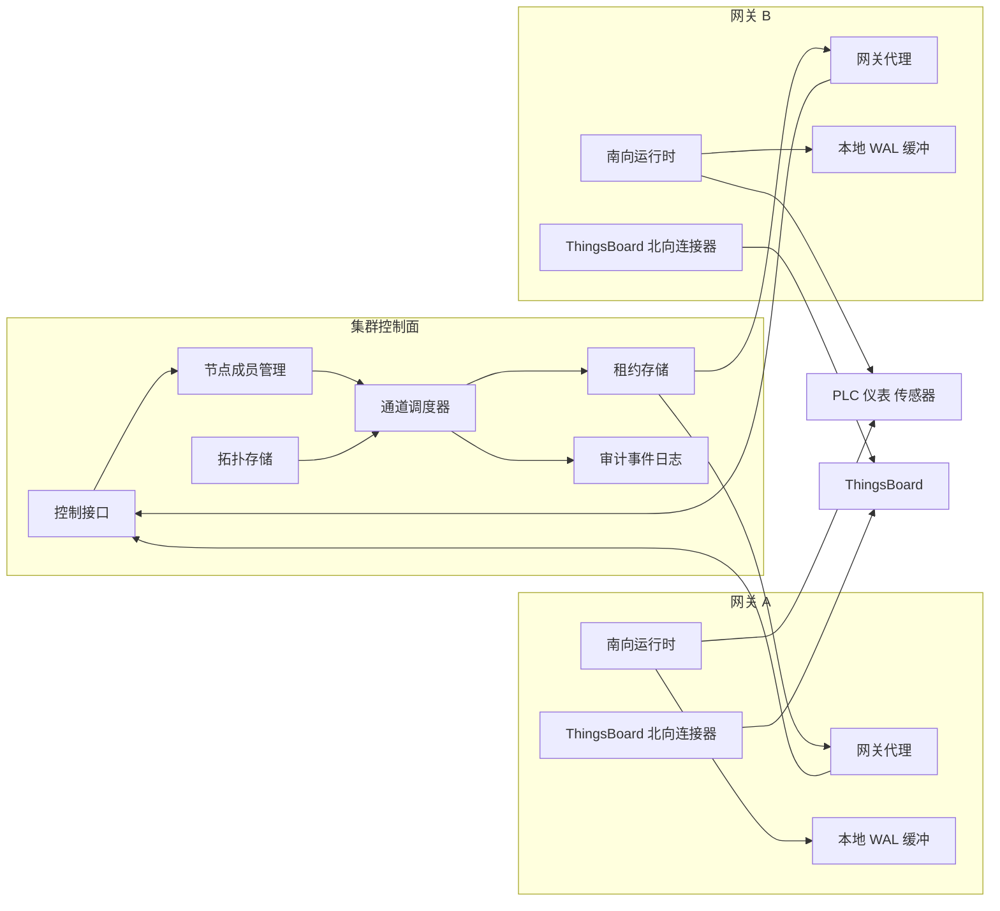
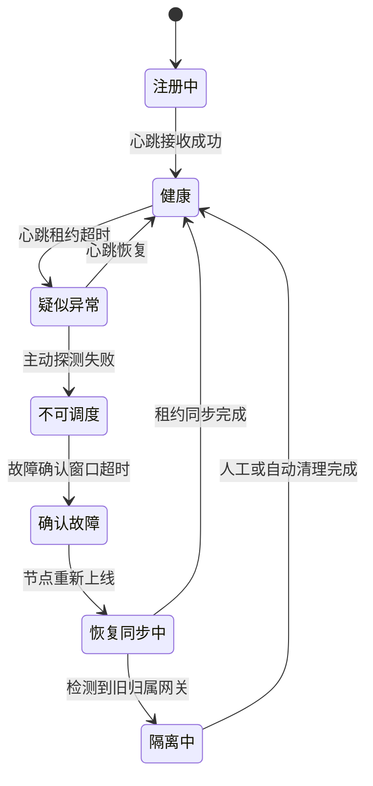
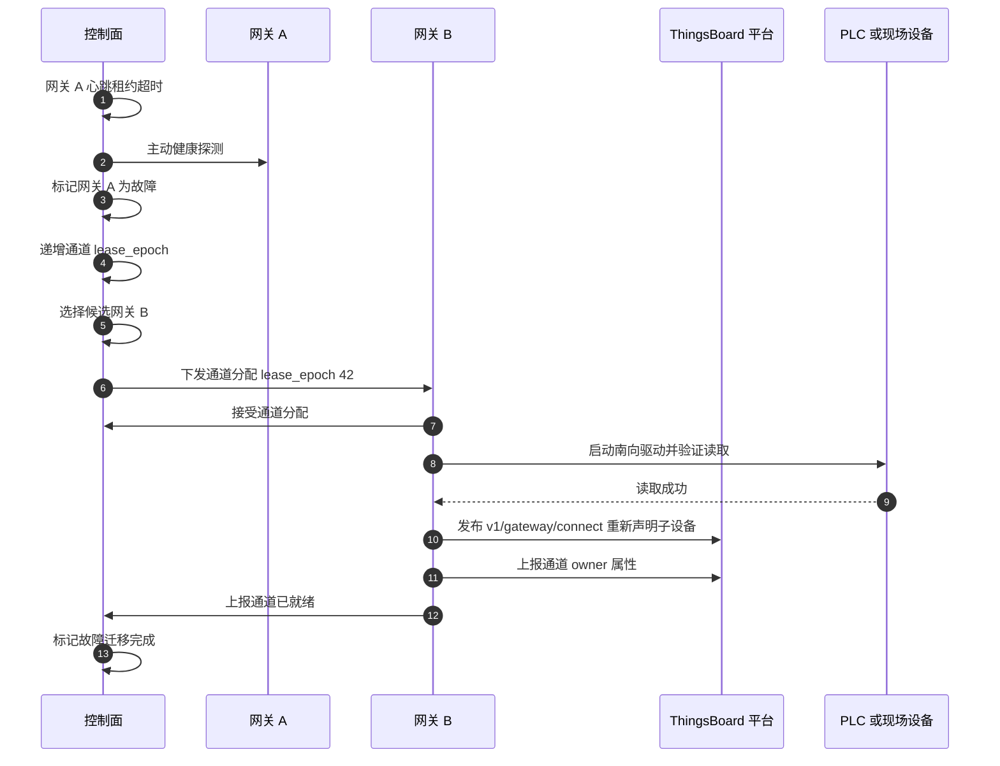
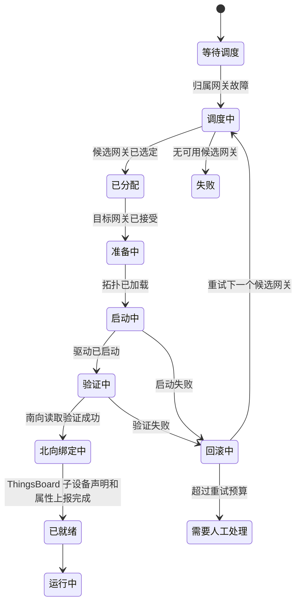

# 井下多网关通道级故障迁移设计

## 1. 背景与目标

在工业井下场景中，通常会部署多台边缘网关，分别接入 PLC、仪表、保护装置、传感器、执行器等现场设备。单台网关可能因为电源、温度、网络、系统盘、进程异常、设备接口损坏等原因失效。

用户提出的核心诉求是：

> 当某台井下网关损坏或掉线时，系统能否把这台坏网关上的南向通道迁移到其他健康网关上继续运行。

本方案的目标不是简单做“进程重启”或“机器主备”，而是实现生产级的 **通道级故障接管**：

- 网关故障后，控制面能可靠发现故障。
- 控制面能判断哪些通道需要迁移。
- 控制面能选择满足协议、网络、资源、拓扑约束的健康网关。
- 新网关能拉起原通道、恢复南向采集、恢复北向 ThingsBoard 子设备上报。
- 整个过程不能产生双 owner、重复控制、错误 RPC 下发或脏数据污染。
- 故障过程、迁移过程、恢复过程可观测、可审计、可演练、可验收。

## 2. 核心结论

生产级设计必须把“网关存活”“通道可用”“北向可用”“业务可用”拆开判断。

推荐架构是：

```text
集群控制面 + 通道租约 + 调度器 + 南向运行时动态分配 + ThingsBoard 子设备稳定身份
```

最关键的设计原则：

- **没有租约，不启动通道。**
- **租约过期，立即停止采集。**
- **lease_epoch 不匹配，不上报 telemetry，不执行 RPC。**
- **目标网关没有完成南向验证，不声明迁移成功。**
- **MQTT ping/pong 只能作为北向健康信号，不能作为网关损坏判断的唯一依据。**
- **K3s/Kubernetes 可以借鉴控制面模式，但工业通道调度必须理解协议、网络和现场资源。**

## 3. 非目标与边界

本设计不承诺“物理不可达设备也能被迁移”。例如：

- 原网关通过本地 RS485 串口直连设备，其他网关没有物理接入能力，则无法软件迁移。
- PLC 只允许原网关 IP 访问，未做白名单冗余，则迁移后新网关可能无法连接。
- 原网关本地 WAL 未复制且整机损坏，则未上报的数据无法保证零丢失。
- 现场网络分区时，少数派网关必须停止服务，不能为了可用性牺牲一致性。

因此，软件高可用必须和现场网络、工业交换机、串口服务器、PLC 访问控制、供电冗余共同设计。

## 4. 总体架构

### 4.1 逻辑视图



### 4.2 控制面职责

控制面负责低频但强一致的动作：

- 节点注册、心跳、租约续期。
- 节点健康状态判定。
- 通道 owner 管理。
- 通道调度和迁移决策。
- 租约 epoch 递增和 fencing。
- 集群拓扑存储。
- 迁移事件审计。
- 灰度、维护、禁调度、手动接管。

### 4.3 数据面职责

数据面负责高频采集和上报：

- 南向协议连接和采集。
- 点位解析、标准化、转换、路由。
- 北向 ThingsBoard telemetry、attributes、RPC。
- 本地 WAL/spool。
- 有界队列和背压。
- 通道级实时指标。

控制面不能参与每条遥测数据的热路径，否则会引入不必要的延迟和单点瓶颈。控制面只决定“谁拥有通道”，数据面负责“高性能运行通道”。

## 5. 核心模型

### 5.1 Node

`Node` 表示一台物理或容器化网关实例。

关键字段：

```yaml
node_id: gw-mine-01-a
boot_id: 3f8b9a...
zone: mine-01
rack: substation-a
ip_addrs:
  - 10.10.1.21
capabilities:
  drivers:
    - modbus
    - s7
    - iec104
  interfaces:
    - eth0
    - eth1
  serial_ports:
    - /dev/ttyS1
resources:
  cpu_cores: 8
  memory_bytes: 8589934592
status: Healthy
last_heartbeat_at: 2026-05-27T09:00:00Z
```

`boot_id` 非常重要。它用于区分“同一个 node_id 的旧进程”和“机器重启后的新进程”，避免旧状态误用。

### 5.2 Channel

`Channel` 表示一个可迁移的南向通道，例如一个 Modbus TCP 连接、一个 S7 PLC 连接、一个 IEC104 链路、一个 OPC UA Client Session。

关键字段：

```yaml
channel_uid: mine-01/plc-room-a/modbus-01
driver: modbus
protocol: modbus_tcp
devices:
  - device_uid: mine-01/pump-01
placement:
  required_zone: mine-01
  required_networks:
    - plc-net-a
  allowed_nodes:
    - gw-mine-01-a
    - gw-mine-01-b
  anti_affinity_group: pump-station-a
owner:
  node_id: gw-mine-01-a
  lease_epoch: 41
  state: Running
```

### 5.3 ChannelLease

`ChannelLease` 是防脑裂的核心。

```yaml
channel_uid: mine-01/plc-room-a/modbus-01
owner_node_id: gw-mine-01-b
owner_boot_id: 87c1...
lease_epoch: 42
lease_deadline: 2026-05-27T09:00:20Z
state: Granted
```

语义：

- 同一时间，一个 `channel_uid` 只能有一个有效 owner。
- 每次迁移必须递增 `lease_epoch`。
- 所有 telemetry、attributes、RPC、控制命令都必须携带或校验当前 epoch。
- 旧 owner 即使恢复，也只能进入 `Recovering`，不能继续服务旧 epoch。

### 5.4 Assignment

`Assignment` 表示控制面希望某通道运行在哪台网关上。

```yaml
channel_uid: mine-01/plc-room-a/modbus-01
desired_node_id: gw-mine-01-b
lease_epoch: 42
phase: Starting
reason: owner_node_not_ready
started_at: 2026-05-27T09:00:11Z
```

## 6. 故障发现闭环

### 6.1 为什么不能只用 MQTT ping/pong

ThingsBoard MQTT ping/pong 只能证明：

- 网关进程到 ThingsBoard MQTT Broker 的 TCP/MQTT 连接还活着。
- 或者这条北向链路断了。

它不能证明：

- 网关南向采集还正常。
- 网关进程没有卡死在其他任务。
- PLC 网络仍然可达。
- 井下交换机没有局部分区。
- 旧网关没有继续向设备写命令。

因此，MQTT ping/pong 必须进入 `northward_health`，但不能作为网关损坏判定的唯一依据。

### 6.2 多信号健康模型

每台网关周期性上报 `NodeHeartbeat`：

```json
{
  "node_id": "gw-mine-01-a",
  "boot_id": "3f8b9a",
  "timestamp_ms": 1780000000000,
  "agent_version": "0.1.0",
  "gateway_version": "0.1.0",
  "resources": {
    "cpu_usage": 0.42,
    "memory_usage": 0.58,
    "disk_usage": 0.61,
    "temperature_celsius": 62.0
  },
  "northward_health": {
    "thingsboard_connected": true,
    "mqtt_keepalive_ok": true,
    "last_publish_success_ms": 1779999999000
  },
  "southward_health": [
    {
      "channel_uid": "mine-01/plc-room-a/modbus-01",
      "phase": "Connected",
      "last_success_read_ms": 1779999998000,
      "consecutive_failures": 0
    }
  ],
  "owned_channels": [
    {
      "channel_uid": "mine-01/plc-room-a/modbus-01",
      "lease_epoch": 41
    }
  ]
}
```

控制面融合以下信号：

- `NodeLease`：节点是否按时续约。
- `Agent RPC`：控制面是否能主动探测节点。
- `Peer Probe`：其他网关是否能探测该节点。
- `Southward Health`：通道是否仍然能读到设备。
- `Northward Health`：ThingsBoard MQTT 是否正常。
- `System Health`：CPU、内存、磁盘、温度、网卡、电源。
- `Process Watchdog`：systemd watchdog 或进程内 watchdog。

### 6.3 节点状态机



状态含义：

- `Healthy`：节点心跳、主动探测、关键资源均正常。
- `Suspect`：心跳短暂超时，尚未迁移，等待主动探测。
- `NotReady`：节点不可调度，已有通道准备迁移。
- `Failed`：确认故障，触发通道迁移。
- `Recovering`：节点恢复上线，但必须先同步控制面状态。
- `Quarantined`：检测到旧 epoch、异常上报、重复 owner，必须隔离。

### 6.4 推荐生产参数

```yaml
heartbeat_interval: 2s
node_lease_ttl: 10s
suspect_probe_timeout: 2s
suspect_probe_attempts: 3
failover_confirm_window: 10s
channel_start_timeout: 15s-60s
maintenance_grace_period: 120s
mqtt_keepalive: 30s-60s
```

井下网络抖动明显时，可以把确认窗口放宽。工业现场宁可晚几秒切换，也不能因为误判造成双 owner、PLC 连接风暴或重复写命令。

## 7. 调度迁移闭环

### 7.1 整体流程



### 7.2 调度分为 Predicate 和 Score

先做硬过滤，再做打分。

硬过滤条件：

- 网关必须 `Healthy`。
- 网关必须支持对应 driver。
- 网关必须能访问目标设备网络。
- 网关必须具备对应串口、网口、VLAN、VPN 或路由。
- 网关资源必须满足通道运行需求。
- 网关版本必须兼容该通道配置。
- 网关必须能访问 ThingsBoard 或本地北向代理。
- 节点不能处于维护、隔离、禁止调度状态。

打分维度：

```text
score =
  network_reachability * 40
+ protocol_compatibility * 25
+ resource_margin * 15
+ topology_affinity * 10
+ historical_stability * 5
+ load_balance * 5
```

说明：

- `network_reachability` 权重最高，因为工业通道迁移首先取决于能不能连到 PLC。
- `protocol_compatibility` 需要考虑协议特性，例如 S7 多客户端限制、Modbus TCP 连接数限制、OPC UA Session 策略。
- `resource_margin` 避免把大量通道迁移到同一台网关导致二次故障。
- `topology_affinity` 优先选择同巷道、同配电区域、同工业交换机下的网关。
- `historical_stability` 避免调度到近期频繁抖动的节点。
- `load_balance` 用于常规均衡，但不能压过工业可达性。

### 7.3 通道迁移状态机



### 7.4 Fencing 防脑裂

故障迁移最危险的问题不是短暂不可用，而是双 owner：

- 两台网关同时采集同一个通道。
- 两台网关同时向 ThingsBoard 上报同一子设备。
- 旧网关恢复后继续执行 RPC。
- 新旧网关同时向 PLC 写控制命令。

必须使用 `lease_epoch` 做 fencing：

```text
channel_uid = mine-01/plc-room-a/modbus-01
old_owner = gw-mine-01-a
old_epoch = 41
new_owner = gw-mine-01-b
new_epoch = 42
```

任何本地动作执行前都校验：

```text
local_owner_node_id == control_plane_owner_node_id
local_lease_epoch == control_plane_lease_epoch
```

校验失败时：

- 停止南向采集。
- 停止执行 RPC 和写点。
- 停止向 ThingsBoard 上报。
- 上报 `stale_lease_detected` 告警。
- 节点进入 `Recovering` 或 `Quarantined`。

## 8. ThingsBoard 北向接入设计

### 8.1 保持子设备稳定身份

ThingsBoard Gateway API 的关键能力是：一个 Gateway 设备可以代理多个子设备。迁移时不要改变子设备身份。

推荐：

- 子设备名称保持稳定，例如 `mine-01/pump-01/plc`.
- 子设备类型保持稳定，例如 `PLC`、`Pump`、`Sensor`.
- owner 信息作为 attributes 上报，不作为设备 identity。

迁移后目标网关发布：

```text
Topic: v1/gateway/connect
Payload: {"device":"mine-01/pump-01/plc","type":"PLC"}
```

再发布 owner attributes：

```json
{
  "cluster_id": "mine-01",
  "owner_node_id": "gw-mine-01-b",
  "channel_uid": "mine-01/plc-room-a/modbus-01",
  "lease_epoch": 42,
  "failover_reason": "owner_node_failed",
  "failover_at": 1780000000000
}
```

### 8.2 MQTT keepalive 的定位

MQTT keepalive 用于北向连接健康：

- keepalive 正常：ThingsBoard MQTT 连接存活。
- keepalive 超时：北向链路异常，需要重连或切换北向出口。
- Last Will：可让 ThingsBoard 感知网关异常断连。

但它不能决定南向通道迁移。通道迁移由控制面的 `NodeLease`、主动探测、南向健康共同决定。

### 8.3 RPC 幂等和 epoch 校验

ThingsBoard 下发 RPC 时，网关必须执行以下校验：

- 子设备是否归属本节点。
- 通道 lease 是否仍有效。
- 本地 `lease_epoch` 是否等于控制面当前 epoch。
- `command_id` 是否已处理过。
- 当前通道是否允许写控制。

推荐 RPC 上下文：

```json
{
  "device": "mine-01/pump-01/plc",
  "data": {
    "id": 10086,
    "method": "write_point",
    "params": {
      "point": "start_command",
      "value": true,
      "lease_epoch": 42,
      "command_id": "cmd-20260527-0001"
    }
  }
}
```

如果 epoch 不匹配，返回拒绝：

```json
{
  "success": false,
  "error": "stale_lease_epoch",
  "current_owner_node_id": "gw-mine-01-b",
  "current_lease_epoch": 42
}
```

### 8.4 ThingsBoard 二次开发建议

如果允许对 ThingsBoard 做二次开发，可以增强为强一致网关集群视图：

- 增加 `GatewayCluster` 资产模型。
- 增加 `GatewayNode` 实体或资产。
- 增加 `Channel` 资产，记录 `channel_uid`、owner、epoch、状态。
- Rule Engine 过滤旧 epoch telemetry。
- RPC 下发前查询当前 owner，只发给合法网关。
- Dashboard 展示迁移历史、RTO、RPO、当前 owner、失败原因。
- 告警规则识别 `stale_lease_detected`、`duplicate_owner_detected`、`failover_retry_exceeded`。

如果不改 ThingsBoard，也可以通过 attributes 和 Rule Engine 完成大部分可观测和审计能力，但服务端强校验能力会弱一些。

## 9. K3s/Kubernetes 的借鉴与边界

### 9.1 值得借鉴的能力

K3s 适合边缘场景，可以借鉴以下思想：

- **NodeLease**：节点用轻量租约表达存活状态。
- **Controller Reconcile**：持续比较 desired state 和 actual state。
- **Scheduler Predicate/Score**：先硬过滤，再打分选择目标节点。
- **Readiness/Liveness**：区分进程存活、服务可用、业务通道可用。
- **Taints/Tolerations**：节点异常、维护、资源不足时禁止调度或驱逐。
- **Finalizer/Fencing**：资源迁移前后进行收尾和隔离。
- **HA datastore**：三节点控制面用 etcd 或 K3s embedded etcd 保证一致性。

### 9.2 不建议直接照搬的地方

K3s/Kubernetes 默认调度的是 Pod，不理解工业现场的特殊约束：

- 串口资源。
- PLC IP 白名单。
- 工业协议连接数限制。
- 现场网络/VLAN/路由。
- 通道级采集状态。
- ThingsBoard 子设备归属。
- 写命令安全边界。

因此 K3s 可以作为部署底座，但通道迁移必须由 `ng-gateway` 自己的控制器完成，或者实现专用的 Kubernetes Operator。

## 10. 三种部署方案

### 10.1 推荐方案：内置集群控制面

适用场景：

- 井下现场资源有限。
- 不希望引入完整 Kubernetes。
- 需要强控制、低依赖、易交付。

组成：

- 3 台网关或边缘控制节点组成控制面 quorum。
- 内置 Raft/etcd/Consul 作为一致性存储。
- 每台业务网关运行 `gateway-agent`。
- 通道调度器内置在控制面。

优点：

- 对工业通道理解最深。
- 依赖少，部署简单。
- 可以深度优化 RTO 和现场约束。

缺点：

- 需要自研控制面能力。
- 需要实现完整运维和升级机制。

### 10.2 K3s + NG Gateway Operator

适用场景：

- 用户现场已经接受 K3s。
- 有统一容器运维体系。
- 希望用 Kubernetes 管理部署、升级、观测。

组成：

- K3s HA server 节点。
- `GatewayNode`、`GatewayChannel`、`ChannelLease` CRD。
- `ng-gateway-operator` 负责通道调度和 reconcile。
- Gateway Pod 可以以 hostNetwork、特权或设备挂载方式访问南向资源。

优点：

- 复用 Kubernetes API、RBAC、事件、监控、升级。
- 多节点部署和运维成熟。
- 容器化交付友好。

缺点：

- 对串口、工业网卡、PLC 网络的建模更复杂。
- Kubernetes 默认故障转移参数偏保守，需要专门调优。
- Operator 仍然必须实现工业通道调度逻辑。

### 10.3 硬件冗余 + 软件 owner 迁移

适用场景：

- 设备强依赖串口或固定网段。
- PLC 访问控制严格。
- 现场对确定性要求高。

组成：

- 冗余工业交换机。
- 串口服务器或双网口 PLC。
- VRRP/Keepalived 或工业网络冗余协议。
- 软件控制面只做 owner、epoch、ThingsBoard 归属迁移。

优点：

- 现场可达性最好。
- 软件不需要解决物理链路不可达问题。
- 更适合强工业约束场景。

缺点：

- 硬件成本更高。
- 现场施工和网络规划要求更高。

## 11. 数据一致性与补偿

### 11.1 RTO 和 RPO 定义

- **RTO**：从旧网关故障到新网关通道恢复采集的时间。
- **RPO**：故障期间最多丢失多少数据。

如果只做通道迁移，不做 WAL 复制：

- RTO 可以做到秒级到几十秒。
- RPO 取决于旧网关损坏前本地缓存是否已上报，整机损坏时可能丢失本地未同步数据。

如果要降低 RPO：

- 通道级 WAL 本地持久化。
- WAL 异步复制到 peer 网关或控制面存储。
- telemetry 使用幂等 key。
- 新 owner 接管后按时间戳和 sequence replay。

### 11.2 WAL 设计建议

每条数据带上：

```yaml
cluster_id: mine-01
channel_uid: mine-01/plc-room-a/modbus-01
device_uid: mine-01/pump-01
point_key: temperature
ts_ms: 1780000000000
seq: 998877
lease_epoch: 42
value: 36.5
```

重放时按以下规则：

- 相同 `channel_uid + point_key + ts_ms + seq` 幂等。
- 旧 epoch 数据可以作为历史补偿，但不能覆盖新 epoch 的实时状态。
- 控制命令不自动重放，除非业务显式声明可重试。

## 12. 安全设计

生产环境必须满足：

- 网关和控制面之间使用 mTLS。
- 每台网关有独立证书和 `node_id` 绑定。
- ThingsBoard Token/X509 凭据加密存储。
- RPC 和写点需要鉴权、审计、幂等。
- 控制面 API 分角色授权：运维、管理员、审计、只读。
- 禁止未授权网关注册成合法节点。
- 节点进入 `Quarantined` 后不能继续接收调度。

## 13. 可观测性与告警

### 13.1 核心指标

节点指标：

- `ng_gateway_cluster_node_heartbeat_age_seconds`
- `ng_gateway_cluster_node_status`
- `ng_gateway_cluster_node_resource_usage_ratio`

通道租约指标：

- `ng_gateway_channel_lease_epoch`
- `ng_gateway_channel_owner_changed_total`
- `ng_gateway_channel_stale_lease_detected_total`

迁移指标：

- `ng_gateway_channel_failover_total`
- `ng_gateway_channel_failover_duration_seconds`
- `ng_gateway_channel_failover_failed_total`
- `ng_gateway_channel_assignment_phase`

数据面指标：

- `ng_gateway_southward_channel_connected`
- `ng_gateway_southward_io_total`
- `ng_gateway_northward_app_connected`
- `ng_gateway_northward_messages_total`

### 13.2 必须告警

- 节点 `NotReady` 超过阈值。
- 通道无 owner。
- 通道迁移失败超过重试预算。
- 检测到 duplicate owner。
- 检测到 stale lease 上报。
- ThingsBoard 北向长时间断连。
- WAL 堆积超过容量阈值。
- 井下网关温度、磁盘、内存异常。

## 14. 故障演练清单

上线前必须完成以下演练：

1. 直接断电旧网关。
2. kill 网关进程。
3. 断开旧网关北向网络。
4. 断开旧网关南向 PLC 网络。
5. 控制面和某网关之间单向网络不通。
6. ThingsBoard MQTT Broker 断开。
7. PLC 拒绝新网关连接。
8. 新 owner 启动一半失败。
9. 旧网关恢复后尝试继续上报旧 epoch。
10. RPC 在迁移过程中下发。
11. 大量通道同时迁移。
12. WAL 堆积后恢复重放。

每次演练必须记录：

- 故障注入时间。
- 控制面判定时间。
- 新 owner 获得 lease 时间。
- 新通道南向验证成功时间。
- ThingsBoard 子设备恢复时间。
- RTO。
- RPO。
- 是否出现重复 owner。
- 是否出现重复 RPC 或误写。

## 15. 实施路线

### 阶段一：集群身份和租约

- 实现 `node_id`、`boot_id`、节点注册。
- 实现 `NodeLease` 心跳。
- 实现 `ChannelLease` 和 `lease_epoch`。
- 南向通道启动前强制校验 lease。
- 北向上报前强制校验 lease。

### 阶段二：控制面调度器

- 建立集群拓扑模型。
- 实现 Predicate/Score 调度。
- 实现通道 assignment 状态机。
- 实现失败重试和回滚。
- 支持手动迁移、禁止调度、维护模式。

### 阶段三：ThingsBoard 故障接管语义

- 子设备稳定 identity。
- 迁移后自动 `v1/gateway/connect`。
- owner attributes 上报。
- RPC 增加 epoch 和 command_id 校验。
- Rule Engine 增加旧 epoch 过滤。

### 阶段四：数据补偿

- 实现通道级 WAL/spool。
- 实现 telemetry 幂等 key。
- 实现故障恢复后补偿重放。
- 可选实现 WAL peer replication。

### 阶段五：生产运维

- 完成 Prometheus 指标。
- 完成 Dashboard。
- 完成告警规则。
- 完成故障演练工具。
- 完成客户现场 Runbook。

## 16. 生产验收标准

必须满足：

- 单台网关断电后，对应通道能自动迁移到健康网关。
- 整个迁移过程不会出现双 owner。
- 旧网关恢复后不会继续执行旧 epoch 采集和 RPC。
- ThingsBoard 子设备 identity 保持不变。
- RPC 在迁移期间不会误下发到旧 owner。
- 迁移事件完整记录，可追溯。
- RTO、RPO 有明确指标并通过演练验证。
- 控制面少数派分区不能继续授予租约。
- 通道没有满足候选网关时，系统明确告警并进入人工处理状态。

建议目标：

```yaml
ethernet_protocol_rto: 10s-30s
serial_via_serial_server_rto: 20s-60s
duplicate_owner_allowed: false
stale_epoch_publish_allowed: false
rpc_without_epoch_allowed: false
manual_intervention_required_alert: true
```

## 17. 最终推荐

面向井下工业项目，推荐采用：

```text
内置集群控制面作为核心方案
+ K3s 思想作为控制面设计参考
+ ThingsBoard Gateway API 保持子设备稳定身份
+ MQTT ping/pong 作为北向健康辅助信号
+ ChannelLease + lease_epoch 作为强一致 fencing 核心
+ WAL/spool 作为数据补偿能力
```

这套方案的关键价值是：它不是“发现机器坏了就盲目重启”，而是围绕工业通道建立完整闭环，从故障发现、调度决策、南向验证、北向恢复、命令安全、数据补偿到审计验收都能被工程化落地。
